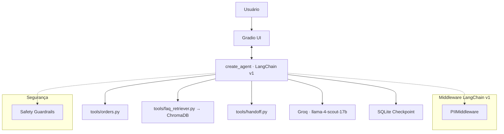

# 🤖 NexusSupport — AI Customer Support Agent

> Agente inteligente de suporte ao cliente para e-commerce, construído com LangChain v1, LangGraph, RAG e FastAPI.

[](https://python.org)
[](https://docs.langchain.com)
[](https://docs.langchain.com/oss/python/langgraph/overview)
[](https://fastapi.tiangolo.com)
[](https://groq.com)

---

## 📌 O que é

NexusSupport é um agente de suporte ao cliente com IA que:

- 🔍 **Consulta status de pedidos** — o agente busca dados do pedido e responde em linguagem natural
- 📚 **Responde FAQ** via RAG — busca na base de conhecimento da loja antes de responder
- 🧠 **Lembra o contexto** — mantém histórico da conversa na sessão via SQLite checkpoint
- 🔒 **Protege dados do usuário** — PII mascarado via `PIIMiddleware` nativo do LangChain v1
- 🙋 **Escala para humano** — quando não sabe ou a situação é sensível, transfere para atendente

---

## 🏗️ Arquitetura



---

## 🗂️ Estrutura do projeto

```
nexus-support/
├── app/
│   ├── main.py                    # entrypoint — FastAPI + Gradio mount
│   │
│   ├── core/                      # configurações e utilitários globais
│   │   ├── config.py              # pydantic-settings — variáveis de ambiente
│   │   ├── logging.py             # logging estruturado em JSON
│   │   └── prompts/
│   │       └── system.md          # system prompt em arquivo separado
│   │
│   ├── agent/
│   │   ├── agent.py               # create_agent + PIIMiddleware
│   │   └── tools/
│   │       ├── orders.py          # consulta de pedidos
│   │       ├── faq_retriever.py   # busca no FAQ via RAG
│   │       └── handoff.py         # escalação para humano
│   │
│   ├── rag/
│   │   ├── ingest.py              # indexação do FAQ no ChromaDB
│   │   └── vectorstore.py         # retrieval por similaridade
│   │
│   ├── api/
│   │   ├── v1/
│   │   │   └── chat.py            # endpoints de chat
│   │   ├── schemas.py             # Pydantic request/response models
│   │
│   └── security/
│       ├── pii.py                 # mask_pii() — usado apenas em logs
│       └── safety.py              # validação contra prompt injection
│
├── data/
│   └── faq/                       # base de conhecimento da loja
├── tests/                         # 31 testes — pytest
├── .env.example
├── .python-version                # Python 3.12
├── pyproject.toml
├── Dockerfile                     # HF Spaces deploy
└── README.md
```

---

## 🚀 Como rodar localmente

> Este projeto usa [uv](https://docs.astral.sh/uv/) para gerenciamento de dependências.
> Instale com: `curl -LsSf https://astral.sh/uv/install.sh | sh`

**1. Clone o repositório**

```bash
git clone https://github.com/edgard-neo/nexus-support.git
cd nexus-support
```

**2. Instale as dependências**

```bash
uv sync
```

O projeto usa o ambiente `.venv` dentro do próprio repositório. Não é
necessário ativar manualmente um ambiente virtual de outro projeto. Para
configurar e executar de forma segura, também é possível usar:

```bash
./scripts/setup.sh
./scripts/run.sh
```

**3. Configure as variáveis de ambiente**

```bash
cp .env.example .env
# Edite o .env com sua GROQ_API_KEY
```

**4. Indexe a base de conhecimento**

```bash
uv run python -m app.rag.ingest
```

**5. Inicie a aplicação**

```bash
uv run uvicorn app.main:app --reload
```

Ou, usando o script que corrige automaticamente um `VIRTUAL_ENV` apontando
para outro clone:

```bash
./scripts/run.sh
```

**6. Acesse a interface**

```
http://localhost:8000
```

---

## 🔌 Endpoints da API

| Método | Rota      | Descrição                |
| ------ | --------- | ------------------------ |
| `POST` | `/api/v1/chat`   | Envia mensagem ao agente |
| `GET`  | `/api/v1/health` | Status da API            |
| `GET`  | `/docs`   | Swagger UI automático    |

**Exemplo de request:**

```bash
curl -X POST http://localhost:8000/api/v1/chat \
  -H "Content-Type: application/json" \
  -d '{"session_id": "user_123", "message": "Qual o status do meu pedido #4521?"}'
```

### Executando os testes

```bash
./scripts/test.sh
```

Se aparecer um aviso informando que `VIRTUAL_ENV` aponta para outro projeto,
execute `deactivate` ou abra um novo terminal e use os scripts acima. Eles
sempre executam a partir da raiz correta do repositório.

**Exemplo de response:**

```json
{
  "response": "Seu pedido #4521 está em trânsito e deve chegar em até 2 dias úteis.",
  "escalated": false,
  "session_id": "user_123"
}
```

---

## 🧠 Decisões técnicas

**Por que `create_agent()` e não LangGraph manual?**
LangChain v1 introduziu `create_agent()` como abstração de alto nível sobre o LangGraph. Elimina a necessidade de definir `graph.py` e `state.py` manualmente, mantendo controle total via middleware e checkpointer.

**Por que PIIMiddleware nativo e não regex manual?**
O LangChain v1 trouxe `PIIMiddleware` como middleware oficial do agente. Mais robusto, aplica mascaramento automaticamente em input e output sem necessidade de interceptar manualmente cada chamada.

**Por que RAG e não fine-tuning?**
O FAQ da loja muda com frequência. RAG permite atualizar a base de conhecimento sem retreinar o modelo — mais rápido, mais barato e mais flexível.

**Por que Groq?**
Latência sub-segundo em respostas. Para suporte ao cliente, tempo de resposta é UX crítica.

**Por que Sentence Transformers local para embeddings?**
Zero custo de API e processamento local dos embeddings. As mensagens ainda são enviadas ao provedor Groq para geração das respostas.

---

## 🔒 Segurança

- PII (CPF, email, telefone, cartão) mascarado via `PIIMiddleware` antes da chamada ao LLM
- Validação de input contra prompt injection em `safety.py`
- API keys via variáveis de ambiente — nunca no código
- `groq_api_key` opcional no build do Docker — injetado via Secret em runtime no HF Spaces

---

## 🗺️ Roadmap

- [x] Estrutura do projeto e arquitetura
- [x] RAG pipeline — indexação e retrieval do FAQ
- [x] Tools — consulta de pedidos, FAQ, escalação
- [x] Agente com `create_agent()` + middleware LangChain v1
- [x] PIIMiddleware
- [x] FastAPI — endpoints REST
- [x] Interface Gradio
- [x] Testes automatizados (31/31)
- [x] Dockerfile + configuração HF Spaces
- [ ] Deploy no Hugging Face Spaces

---

## 👨‍💻 Autor

**Edgard Mendes** — AI Engineer em formação
[GitHub](https://github.com/edgard-neo) · [LinkedIn](https://www.linkedin.com/in/codewithedgard/)

---

## 📄 Licença

MIT — use, modifique e distribua livremente.
